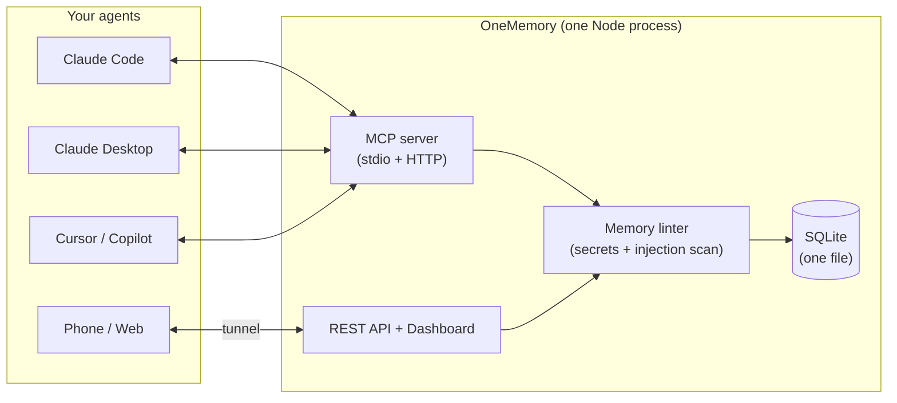

# OneMemory

**One small, self-hosted memory store that every AI agent you use can share — over MCP or plain REST, from your desktop, the web, or your phone.**

[](https://github.com/calasdan-sketch/onememory/actions/workflows/ci.yml)
[](https://www.npmjs.com/package/@decnutz/onememory)


Write a note from Claude Code on your desktop; read it back from Claude on
your phone in a fresh chat. Same store for Claude Code, Claude Desktop,
claude.ai, Claude mobile, Cursor, Copilot, Cline, Continue, n8n — anything
that speaks MCP or HTTP.

---

## Quickstart

> **Requires Node.js 24 or newer.** OneMemory uses Node's built-in
> `node:sqlite`, which does not exist in Node 22 or older. Check with
> `node -v`. Can't upgrade? Use [Docker](#docker) instead.

```bash
npm i -g @decnutz/onememory                           # 1. install
claude mcp add onememory -- onememory mcp        # 2. wire it into Claude Code (stdio)
onememory doctor                                 # 3. verify Node, database, token
```

Then, in Claude, say **"remember that my staging server is on port 8443"**,
and in a fresh chat ask "what port is my staging server on?". Step 4, only
if you want the dashboard, REST API and MCP-over-HTTP (the `curl` examples
below need it): `onememory start`.

No global install: `claude mcp add onememory -- npx -y @decnutz/onememory mcp`.
`onememory init` prints the config for Claude Desktop / Cursor / Copilot;
[INSTALL.md](./INSTALL.md) has every client.

`onememory start` serves the dashboard and REST API on `:8790` and
MCP-over-HTTP on `:8791` (bound to `127.0.0.1`). To reach it from your phone
or claude.ai, put an authenticated tunnel (Cloudflare Tunnel + Access,
Tailscale, or your own TLS proxy) in front of `:8791` — see
[INFRA.md](./INFRA.md).

Plain REST works too once `onememory start` is running (the token is in
`~/.onememory/.token`):

```bash
TOKEN=$(cat ~/.onememory/.token)
curl -X POST localhost:8790/notes -H "Authorization: Bearer $TOKEN" -H "Content-Type: application/json" -d '{"title":"Deploy day","body":"Shipped v1.1"}'
curl -H "Authorization: Bearer $TOKEN" "localhost:8790/search?q=deploy"
```

### Where your data lives

Everything (database, token, scoped tokens, spaces config) lives in
`~/.onememory` (Windows: `%USERPROFILE%\.onememory`), outside the installed
package, so `npm update` and npx cache cleanups never touch it. Set
`ONEMEMORY_HOME` to put it elsewhere, or `ONEMEMORY_DB_PATH` for just the
database. On macOS/Linux the folder is owner-only (`0700`, files `0600`).
A from-source git checkout that already has `./data/state.db` keeps using
it. `onememory doctor` shows which directory is in use.

**Upgrading from an early 1.0.x install** (data kept inside the package folder): copy it yourself before removing the old package, e.g. `mkdir -p ~/.onememory && cp -Rn "$(npm root -g)/onememory-mcp/data/." ~/.onememory/` (Windows: `%APPDATA%\npm\node_modules\onememory-mcp\data\*` to `%USERPROFILE%\.onememory\`), then run `onememory rebuild-edges` once.

### Docker

```bash
cp .env.example .env     # set ONEMEMORY_TOKEN (openssl rand -hex 32)
docker compose up -d     # dashboard at http://localhost:8790
```

### Backups & restore

```bash
onememory backup --out ~/om-backup     # consistent hot copy; safe while the server runs
```

`onememory backup` writes `state.db` (via SQLite `VACUUM INTO`) plus, if
at-rest encryption is on, a copy of the `.key` file. **Keep the key apart from
the backup**: a backup without its key is unreadable, and one stored next to it
is not encrypted. See [INFRA.md](./INFRA.md#7-backups). The JSON route (admin
token) also works:

```bash
TOKEN=$(cat ~/.onememory/.token)
curl -H "Authorization: Bearer $TOKEN" localhost:8790/export > backup.json   # or: onememory export --format json --out backup.json
curl -X POST -H "Authorization: Bearer $TOKEN" -H "Content-Type: application/json" \
  --data-binary @backup.json localhost:8790/import                           # admin scope only
```

- **Restore into an empty store.** `POST /import` does not de-duplicate:
  importing a backup into a store that already holds those notes creates
  duplicates.
- **Backups are snapshots of current notes, not per-edit history.** OneMemory
  keeps only the latest version of each note (the `rev` counter tracks edits;
  it is not a snapshot list), so a store with months of edits exports as one
  entry per note with its latest body — export time and size track your note
  count, not how often you rewrote them. The change feed's per-edit log is
  metadata only (titles, no bodies), pruned after 90 days, and is not part of
  a JSON backup.
- **Exports stream.** `GET /export` and `onememory export --format json` page
  through the store and write as they go, so peak memory is one page (500
  notes) regardless of store size — a multi-month store dumps in one pass.
- **Restores keep the history that exists.** `created_at`, `updated_at`,
  `source` and the `rev` counter all survive the round trip (a note at rev 26
  stays at rev 26, so `if_rev` guards and the change feed stay accurate).
  Imports over 200 notes land in seconds and defer the O(n²) similarity-graph
  rebuild — the response says so and search works immediately; run
  `onememory rebuild-edges` when you want neighbor ranking back. Restored
  notes are re-embedded automatically when semantic search is enabled.
- Markdown (one file per note, git-friendly) is a separate path:
  `onememory export --format md --dir ~/memory` — see
  [docs/file-sync.md](./docs/file-sync.md).

---

## What makes it different

- **Small footprint.** One Node process, one SQLite file, **2 direct runtime
  dependencies** (`@modelcontextprotocol/sdk`, `zod`; ~94 packages installed
  in total, mostly the MCP SDK's own), no native modules, no vector database,
  no Python. Back it up by copying one file.
- **Change feed.** `memory_since` / `GET /changes`: "what changed while I was
  away" — created, updated **and deleted** notes grouped by source, with a
  per-device "since I last looked" marker. Driven by a local change log, so
  restores, file-sync imports and deletes are never missed. → [docs/change-feed.md](./docs/change-feed.md)
- **Live wait.** `GET /changes?wait=25` / `memory_since { wait_seconds: 25 }` parks
  until something changes in your scope, so a session sees an idea added from
  your phone within moments instead of on its next poll. **Use 25, not the 55
  maximum:** many proxies and tunnels cut an idle response at 30s (a 55s wait
  behind one died at 30.0s). Bounded (16 per token), and a dropped client or a
  server shutdown frees its slot; `ack_mode: "manual"` makes delivery
  at-least-once. → [docs/change-feed.md](./docs/change-feed.md#live-wait)
- **Task board, handoffs, catch-up.** `task_put` / `task_get` / `task_list` /
  `task_claim`, `session_handoff`, and one `catch_up` call (changes since you last looked +
  open tasks + latest handoff). Built on plain notes, so it is encrypted,
  namespaced and searchable like the rest; `onememory recall` includes open
  tasks and the latest handoff at session start. → [docs/tasks.md](./docs/tasks.md)
- **Memory linter.** Every write is scanned for secrets (API keys, JWTs,
  private keys, high-entropy tokens) and prompt-injection instructions
  ("ignore previous instructions", chat-template markers, tool-call
  coercion). Secrets are blocked; injection is quarantined for admin review
  and invisible to search and recall until approved. It is a pattern
  linter, with unit tests but no published false-positive rate: expect misses
  and the occasional false flag. → [docs/memory-linter.md](./docs/memory-linter.md)
- **Plain-file sync.** `onememory export --format md --dir` writes one
  Markdown file per note with YAML front-matter, deterministic and
  git-friendly; `onememory import --dir` merges edits back three-way — newer
  wins, conflicts reported and the losing version kept, never silently lost.
  Works across machines through GitHub or Syncthing. → [docs/file-sync.md](./docs/file-sync.md)
- **Scoped tokens.** `read` / `write` / `admin` bearer tokens, enforced
  identically on REST and MCP — give your phone a read token and a leaked
  token can't wipe the store.
- **MCP *and* a plain REST API** on the same store, plus a small dashboard.

Also included: optional semantic / hybrid search with your own embeddings
endpoint (Ollama or any OpenAI-compatible API), natural-language time
filters ("yesterday evening"), staleness warnings, near-duplicate
consolidation, a similarity graph, access-based ranking, server-side
namespace isolation, and a Claude Code SessionStart recall hook.
→ [docs/search.md](./docs/search.md)

---

## How it works



Write once from your desktop, read back from your phone — every agent
shares the same store.

## How it compares

Other good projects solve overlapping problems, and we have not verified a
feature-by-feature comparison against their current releases, so we do not
publish one. Read their own docs and pick on your needs:

- [mcp-memory-service](https://github.com/doobidoo/mcp-memory-service),
  [Basic Memory](https://github.com/basicmachines-co/basic-memory),
  [OpenMemory (mem0)](https://docs.mem0.ai/openmemory) and the
  [official MCP memory server](https://github.com/modelcontextprotocol/servers/tree/main/src/memory)
  are all worth a look.

What OneMemory itself provides (all of it checkable in this repo): MIT
license, Node 24+ with 2 direct runtime dependencies, one SQLite file,
MCP over stdio and HTTP plus a REST API, optional semantic search with your
own embeddings endpoint, a change feed that includes deletes, a write-time
secret and injection linter, Markdown export and three-way import, scoped
tokens with optional per-token namespaces, and optional AES-256-GCM
encryption of note bodies. See [SECURITY.md](./SECURITY.md) for what it does
**not** do.

---

## MCP tools

| Tool | Scope | |
|---|---|---|
| `state_write` / `state_read` / `state_delete` | write / read / admin | CRUD with compare-and-swap (`if_rev`) and provenance (`source`) |
| `state_search` / `state_relevant` / `state_list` | read | keyword, semantic or hybrid search; vague-message recall; listing |
| `memory_since` | read | change feed (`wait_seconds` = live wait) |
| `task_put` / `task_list` / `task_get` | write / read / read | shared task board across devices and models; `client_key` makes a create retry-safe |
| `task_claim` | write | take / heartbeat / release a task with a lease (compare-and-swap) |
| `task_approve` | admin | approve a command task so the PC's runner may run it ([RUNNER.md](./docs/RUNNER.md)) |
| `session_handoff` / `catch_up` | write / read | leave a handoff; one-call catch-up at session start |
| `memory_ack` | read | confirm a manual-ack change-feed page |
| `memory_stats` | read | totals, most-read, never-read, stale |
| `memory_quarantine` | admin | review linter-held writes |
| `memory_consolidation_candidates` / `memory_consolidate` / `memory_rebuild_edges` | admin | dedup and similarity-graph maintenance |

REST mirrors them (`/notes`, `/search`, `/relevant`, `/changes`, `/tasks`, `/handoffs`, `/catch-up`, `/stats`,
`/export`, `/import`, …). Full reference: [docs/architecture.md](./docs/architecture.md).

## CLI

```
onememory start | mcp | doctor | init
onememory changes --since last --consumer laptop
onememory watch --consumer pc [--exec program args...]     # react to changes as they land
onememory backup [--out dir] [--include-approval-key]       # hot copy of the database (+ key)
onememory export --format md --dir ~/memory     onememory import --dir ~/memory
onememory quarantine [list | approve <id> | reject <id>]
onememory consolidate | rebuild-edges | reindex | relevant "…" | recall
```

`onememory help` explains each. The CLI runs with full local trust (no
token).

---

## Security in one paragraph

Loopback by default and fail-closed: it refuses to bind a public interface
without an explicit `ONEMEMORY_TOKEN`. Constant-time bearer auth on every
data route, scoped tokens, DNS-rebinding Origin checks, per-client rate
limits, size caps, an append-only audit log without note content, the
write-time linter above, and an untrusted-data banner on every MCP read (REST responses do not
carry it) so agents treat note content as data, not instructions. Optional AES-256-GCM
encryption at rest for note bodies only (`onememory encrypt enable`; titles,
tags, timestamps and embeddings stay readable), per-note
TTL with reversible soft-archive, and `?explain=1` so a caller can see why
a memory was retrieved. **Per-token namespace permissions** pin a token to
one namespace so a single shared bridge stays isolated per agent — a pinned
admin token is still confined. Your notes stay in one
file on your machine; a tunnel only carries requests. Details and known
limits: [SECURITY.md](./SECURITY.md),
[docs/token-namespaces.md](./docs/token-namespaces.md), and
[docs/encryption-retention.md](./docs/encryption-retention.md).

**About the retrieval eval.** `evals/cross-device-tasks.json` is 10 tasks over
10 notes and lexically easy; its perfect score is a regression gate in CI,
not evidence of retrieval quality. Keyword-only `state_search` scores 0.70
recall@1 on it. See [docs/encryption-retention.md](./docs/encryption-retention.md#the-evaluation-set).

## Documentation

| | |
|---|---|
| [INSTALL.md](./INSTALL.md) | every MCP client |
| [INFRA.md](./INFRA.md) | tunnels, phone/web access, n8n |
| [docs/configuration.md](./docs/configuration.md) | all environment variables, server-side namespace resolution |
| [docs/search.md](./docs/search.md) | semantic, time-aware and relevant search; staleness; consolidation |
| [docs/change-feed.md](./docs/change-feed.md) | `memory_since` / `GET /changes` |
| [docs/tasks.md](./docs/tasks.md) | task board, claims, command tasks, handoffs, one-call catch-up |
| [docs/memory-linter.md](./docs/memory-linter.md) | `ONEMEMORY_LINT`, detection rules, quarantine |
| [docs/file-sync.md](./docs/file-sync.md) | Markdown export/import, GitHub and Syncthing workflows |
| [docs/sessionstart-hook.md](./docs/sessionstart-hook.md) | automatic recall at Claude Code session start |
| [docs/encryption-retention.md](./docs/encryption-retention.md) | at-rest encryption, retention (TTL + archive), retrieval visibility |
| [docs/token-namespaces.md](./docs/token-namespaces.md) | per-token namespace permissions — one shared bridge, isolated agents |
| [docs/architecture.md](./docs/architecture.md) | modules, tools, REST API, schema |
| [SKILL.md](./SKILL.md) | when and how an agent should use the memory |
| [CHANGELOG.md](./CHANGELOG.md) | release notes |

## Credits

Several ideas were adapted from other open projects, with thanks:

- **[llmem](https://github.com/netrixone/llmem)** — consolidation candidates,
  the similarity-edge graph, access-count importance, `#status` staleness, and
  the context/relevant split with keyword extraction.
- **lontar** (rymanalu, described in *"One memory across AI agents: what it
  actually takes"* on dev.to) — the fail-silent SessionStart recall hook,
  server-side namespace resolution from the working directory, and
  one-directional `reads_from` grants.
- **[lossless-memory](https://github.com/aru-labs/lossless-memory)** —
  natural-language time phrases as a first-class query filter.

## License

MIT — see [LICENSE](./LICENSE). Built by Dan Calas / Calas Automations Inc.
