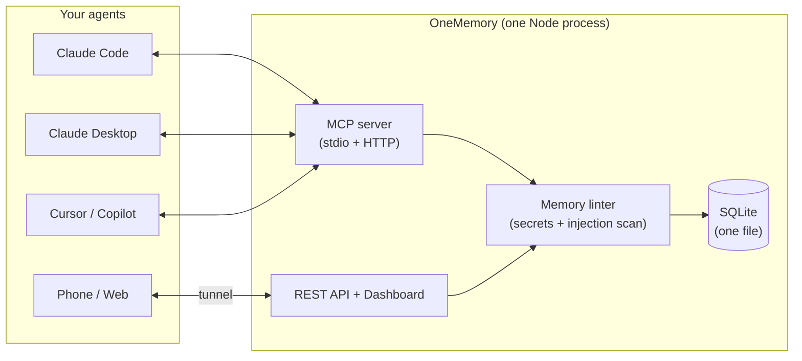

# OneMemory

**One small, self-hosted memory store that every AI agent you use can share — over MCP or plain REST, from your desktop, the web, or your phone.**

[](https://github.com/calasdan-sketch/onememory/actions/workflows/ci.yml)
[](https://www.npmjs.com/package/onememory-mcp)


Write a note from Claude Code on your desktop; read it back from Claude on
your phone in a fresh chat. Same store for Claude Code, Claude Desktop,
claude.ai, Claude mobile, Cursor, Copilot, Cline, Continue, n8n — anything
that speaks MCP or HTTP.

---

## Quickstart

> **Requires Node.js 24 or newer.** OneMemory uses Node's built-in
> `node:sqlite`, which does not exist in Node 22 or older. Check with
> `node -v`. Can't upgrade? Use [Docker](#docker) instead.

### Install in 60 seconds

```bash
npx onememory-mcp setup
```

`setup` finds Claude Code, Claude Desktop and Cursor on this computer, shows you in plain words what it will do and the exact
lines it will change, saves a backup of each file, and writes only after you type `y`. Then it writes a first test note, reads it
back, runs `onememory doctor` and tells you how to check it inside Claude Code (type `/mcp`). To look first: `npx onememory-mcp setup
--dry-run`. To go back: `onememory setup --undo`. It changes only the OneMemory entry; your other servers and settings stay as they
are. **Coming from claude-bridge** (the old name)? It offers to move that entry across and keeps your data. Step by step, with
troubleshooting: [docs/live-claude-code.md](./docs/live-claude-code.md).

Already have notes in Claude Code? `onememory import --claude --dry-run` shows what could be brought in from your `CLAUDE.md` files and
Claude Code's auto memory (secrets are skipped, nothing leaves your computer). Coming from claude-mem, mem0 or basic-memory?
`onememory import --from claude-mem --dry-run` (or `mem0 --path export.json`, `basic-memory`); see [docs/switching.md](./docs/switching.md)
for the import and a clean uninstall of the old tool.

The manual way, if you prefer:

```bash
npm i -g onememory-mcp                           # 1. install
claude mcp add onememory -- onememory mcp        # 2. wire it into Claude Code (stdio)
onememory doctor                                 # 3. verify Node, database, token
```

Then, in Claude, say **"remember that my staging server is on port 8443"**,
and in a fresh chat ask "what port is my staging server on?". Step 4, only
if you want the dashboard, REST API and MCP-over-HTTP (the `curl` examples
below need it): `onememory start`.

No global install: `claude mcp add onememory -- npx -y onememory-mcp mcp`.
`onememory init` prints the config for Claude Desktop / Cursor / Copilot;
[INSTALL.md](./INSTALL.md) has every client.

`onememory start` serves the dashboard and REST API on `:8790` and
MCP-over-HTTP on `:8791` (bound to `127.0.0.1`). To reach it from your phone
or claude.ai, put an authenticated tunnel (Cloudflare Tunnel + Access,
Tailscale, or your own TLS proxy) in front of `:8791` — see
[INFRA.md](./INFRA.md).

Plain REST works too once `onememory start` is running (the token is in
`~/.onememory/.token`):

```bash
TOKEN=$(cat ~/.onememory/.token)
curl -X POST localhost:8790/notes -H "Authorization: Bearer $TOKEN" -H "Content-Type: application/json" -d '{"title":"Deploy day","body":"Shipped v1.1"}'
curl -H "Authorization: Bearer $TOKEN" "localhost:8790/search?q=deploy"
```

### Where your data lives

Everything (database, token, scoped tokens, spaces config) lives in
`~/.onememory` (Windows: `%USERPROFILE%\.onememory`), outside the installed
package, so `npm update` and npx cache cleanups never touch it. Set
`ONEMEMORY_HOME` to put it elsewhere, or `ONEMEMORY_DB_PATH` for just the
database. On macOS/Linux the folder is owner-only (`0700`, files `0600`).
A from-source git checkout that already has `./data/state.db` keeps using
it. `onememory doctor` shows which directory is in use.

**Upgrading from an early 1.0.x install** (data kept inside the package folder): copy it yourself before removing the old package, e.g. `mkdir -p ~/.onememory && cp -Rn "$(npm root -g)/onememory-mcp/data/." ~/.onememory/` (Windows: `%APPDATA%\npm\node_modules\onememory-mcp\data\*` to `%USERPROFILE%\.onememory\`), then run `onememory rebuild-edges` once.

### Docker

```bash
cp .env.example .env     # set ONEMEMORY_TOKEN (openssl rand -hex 32)
docker compose up -d     # dashboard at http://localhost:8790
```

### Backups & restore

```bash
onememory backup --out ~/om-backup     # consistent hot copy; safe while the server runs
```

(The attestation signing key `.attest-key` is not copied; see [docs/trust.md](./docs/trust.md#setting-it-up-between-two-servers).)


`onememory backup` writes `state.db` (via SQLite `VACUUM INTO`) plus, if
at-rest encryption is on, a copy of the `.key` file. **Keep the key apart from
the backup**: a backup without its key is unreadable, and one stored next to it
is not encrypted. See [INFRA.md](./INFRA.md#7-backups). The JSON route (admin
token) also works:

```bash
TOKEN=$(cat ~/.onememory/.token)
curl -H "Authorization: Bearer $TOKEN" localhost:8790/export > backup.json   # or: onememory export --format json --out backup.json
curl -X POST -H "Authorization: Bearer $TOKEN" -H "Content-Type: application/json" \
  --data-binary @backup.json localhost:8790/import                           # admin scope only
```

- **Restore into an empty store.** `POST /import` does not de-duplicate:
  importing a backup into a store that already holds those notes creates
  duplicates.
- **Backups are snapshots of current notes, not per-edit history.** OneMemory
  keeps only the latest version of each note (the `rev` counter tracks edits;
  it is not a snapshot list), so a store with months of edits exports as one
  entry per note with its latest body — export time and size track your note
  count, not how often you rewrote them. The change feed's per-edit log is
  metadata only (titles, no bodies), pruned after 90 days, and is not part of
  a JSON backup.
- **Exports stream.** `GET /export` and `onememory export --format json` page
  through the store and write as they go, so peak memory is one page (500
  notes) regardless of store size — a multi-month store dumps in one pass.
- **Restores keep the history that exists.** `created_at`, `updated_at`,
  `source` and the `rev` counter all survive the round trip (a note at rev 26
  stays at rev 26, so `if_rev` guards and the change feed stay accurate).
  Imports over 200 notes land in seconds and defer the O(n²) similarity-graph
  rebuild — the response says so and search works immediately; run
  `onememory rebuild-edges` when you want neighbor ranking back. Restored
  notes are re-embedded automatically when semantic search is enabled.
- Markdown (one file per note, git-friendly) is a separate path:
  `onememory export --format md --dir ~/memory` — see
  [docs/file-sync.md](./docs/file-sync.md).

---

## Automatic memory

OneMemory can also remember what Claude Code *does*, without anyone writing a note:

```bash
onememory setup --capture        # or answer y to "Also record what Claude does in this project ...?"
```

- **What is recorded:** prompts, tool calls, file edits, commands and their errors, through Claude Code's hooks
  (`onememory hook <event>`). Only on this machine, in the same SQLite file; raw events are deleted after 7 days
  (`ONEMEMORY_CAPTURE_RETENTION_DAYS`).
- **What is kept:** a free, deterministic distiller (no model call) turns each session into a few **observations**
  (a commit typed by its `fix:` / `feat:` / `refactor:` prefix, a test that failed and then passed, a decision you
  stated, a secret that was kept out) and one **session summary** (request, files, commands, outcome, next step).
  They are ordinary notes with a `kind`, so lint, quarantine, history, search and the trust policy apply to them,
  and they never show up in `state_list` / `state_search` unless asked for.
- **Private by default:** `<private>...</private>` blocks are dropped and secrets are replaced with
  `[REDACTED:<type>]` *before* anything is stored. `ONEMEMORY_CAPTURE=off` stops it; `ONEMEMORY_CAPTURE_EXCLUDE`
  skips folders; `ONEMEMORY_CAPTURE_SKIP_TOOLS` skips tools.
- **Never in the way:** every hook exits 0 and never migrates the database. If the database is busy or from another
  version, the (already redacted) event waits in a spool file and is stored by a later hook.
- **Back at the next session:** the start-of-session context is ranked by what you are working on (git branch, changed
  files, recent work), packed into `ONEMEMORY_RECALL_TOKENS` (1500), and ends with what it stands in for.
- **Looking things up:** `memory_index` (compact rows) → `memory_timeline` (what happened around one) →
  `memory_get` (full text, cite as `om:#id`), plus `session_list`. REST: `GET /index`, `GET /timeline`, `POST /get`,
  `GET /sessions`, `GET /files/timeline?path=`. The [onememory-mem skill](./skills/onememory-mem/SKILL.md) teaches
  an agent this order.
- **Before a file is read:** a `PreToolUse` hook on `Read` (`onememory hook file-context`, installed with
  `--capture`) tells the agent which memories are linked to that file, once per session per file. It is advisory
  only: it never blocks, allows or changes the Read. Same namespace, trust and UNTRUSTED-banner rules as the
  start-of-session context.
- **In the dashboard:** the **Sessions** tab lists recorded sessions; open one for its timeline (summary, prompts,
  observations, oldest first).
- **Optional local model:** set `ONEMEMORY_LLM_URL` (an OpenAI-compatible server such as Ollama,
  `http://127.0.0.1:11434`) and `ONEMEMORY_LLM_MODEL`, and at session end one call rewrites the session summary in
  plain words. Off by default; only a loopback URL is accepted (`ONEMEMORY_LLM_ALLOW_REMOTE=1` to override); bounded
  by `ONEMEMORY_LLM_TIMEOUT_MS`; the answer is redacted and linted like any write, and on any failure the automatic
  summary stays.
- **Moves with your data:** export / import and the Markdown vault sync carry an observation's kind, session, type
  and files; `onememory encrypt enable` seals captured event outputs too. Captured rows are left out of the stale
  count, `memory_stats` totals and consolidation.

**Semantic search when available:** `ONEMEMORY_EMBEDDINGS=auto` uses your local embedding endpoint when it answers
and quietly stays on keyword search when it does not (it retries once a minute).

`onememory doctor` shows whether the hooks are wired, the last captured event and the spool size;
`onememory setup --undo` takes the hooks out again.

---

## What makes it different

- **Small footprint.** One Node process, one SQLite file, **2 direct runtime
  dependencies** (`@modelcontextprotocol/sdk`, `zod`; ~94 packages installed
  in total, mostly the MCP SDK's own), no native modules, no vector database,
  no Python. Back it up by copying one file.
- **Change feed.** `memory_since` / `GET /changes`: "what changed while I was
  away" — created, updated **and deleted** notes grouped by source, with a
  per-device "since I last looked" marker. Driven by a local change log, so
  restores, file-sync imports and deletes are never missed. → [docs/change-feed.md](./docs/change-feed.md)
- **Live wait.** `GET /changes?wait=25` / `memory_since { wait_seconds: 25 }` parks
  until something changes in your scope, so a session sees an idea added from
  your phone within moments instead of on its next poll. **Use 25, not the 55
  maximum:** many proxies and tunnels cut an idle response at 30s (a 55s wait
  behind one died at 30.0s). Bounded (16 per token), and a dropped client or a
  server shutdown frees its slot; `ack_mode: "manual"` makes delivery
  at-least-once. → [docs/change-feed.md](./docs/change-feed.md#live-wait)
- **Task board, handoffs, catch-up.** `task_put` / `task_get` / `task_list` /
  `task_claim`, `session_handoff`, and one `catch_up` call (changes since you last looked +
  open tasks + latest handoff). Built on plain notes, so it is encrypted,
  namespaced and searchable like the rest; `onememory recall` includes open
  tasks and the latest handoff at session start. → [docs/tasks.md](./docs/tasks.md)
- **Memory linter.** Every write is scanned for secrets (API keys, JWTs,
  private keys, high-entropy tokens) and prompt-injection instructions
  ("ignore previous instructions", chat-template markers, tool-call
  coercion). Secrets are blocked; injection is quarantined for admin review
  and invisible to search and recall until approved. It is a pattern
  linter, with unit tests but no published false-positive rate: expect misses
  and the occasional false flag. → [docs/memory-linter.md](./docs/memory-linter.md)
- **Plain-file sync.** `onememory export --format md --dir` writes one
  Markdown file per note with YAML front-matter, deterministic and
  git-friendly; `onememory import --dir` merges edits back three-way — newer
  wins, conflicts reported and the losing version kept, never silently lost.
  Works across machines through GitHub or Syncthing. → [docs/file-sync.md](./docs/file-sync.md)
- **Scoped tokens.** `read` / `write` / `admin` bearer tokens, enforced
  identically on REST and MCP — give your phone a read token and a leaked
  token can't wipe the store.
- **MCP *and* a plain REST API** on the same store, plus a small dashboard.

Also included: optional semantic / hybrid search with your own embeddings
endpoint (Ollama or any OpenAI-compatible API), natural-language time
filters ("yesterday evening"), staleness warnings, near-duplicate
consolidation, a similarity graph, access-based ranking, server-side
namespace isolation, and a Claude Code SessionStart recall hook.
→ [docs/search.md](./docs/search.md)

---

## How it works



Write once from your desktop, read back from your phone — every agent
shares the same store.

## How it compares

Other good projects solve overlapping problems, and we have not verified a
feature-by-feature comparison against their current releases, so we do not
publish one. Read their own docs and pick on your needs:

- [mcp-memory-service](https://github.com/doobidoo/mcp-memory-service),
  [Basic Memory](https://github.com/basicmachines-co/basic-memory),
  [OpenMemory (mem0)](https://docs.mem0.ai/openmemory) and the
  [official MCP memory server](https://github.com/modelcontextprotocol/servers/tree/main/src/memory)
  are all worth a look.

What OneMemory itself provides (all of it checkable in this repo): MIT
license, Node 24+ with 2 direct runtime dependencies, one SQLite file,
MCP over stdio and HTTP plus a REST API, optional semantic search with your
own embeddings endpoint, a change feed that includes deletes, a write-time
secret and injection linter, Markdown export and three-way import, scoped
tokens with optional per-token namespaces, and optional AES-256-GCM
encryption of note bodies. See [SECURITY.md](./SECURITY.md) for what it does
**not** do.

---

## MCP tools

| Tool | Scope | |
|---|---|---|
| `state_write` / `state_read` / `state_delete` | write / read / admin | CRUD with compare-and-swap (`if_rev`) and provenance (`source`) |
| `state_search` / `state_relevant` / `state_list` | read | keyword, semantic or hybrid search; vague-message recall; listing |
| `memory_since` | read | change feed (`wait_seconds` = live wait) |
| `task_put` / `task_list` / `task_get` | write / read / read | shared task board across devices and models; `client_key` makes a create retry-safe |
| `task_claim` | write | take / heartbeat / release a task with a lease (compare-and-swap) |
| `task_approve` | admin | approve a command task so the PC's runner may run it ([RUNNER.md](https://github.com/calasdan-sketch/onememory/blob/main/docs/RUNNER.md)) |
| `runner_status` | read | is the PC's runner listening, and how many approved commands are waiting for it (`onememory runner-status`, `GET /runner/status`; [RUNNER.md](https://github.com/calasdan-sketch/onememory/blob/main/docs/RUNNER.md)) |
| `session_handoff` / `catch_up` | write / read | leave a handoff; one-call catch-up at session start |
| `memory_ack` | read | confirm a manual-ack change-feed page |
| `memory_stats` | read | totals, most-read, never-read, stale |
| `memory_quarantine` | admin | review linter-held writes |
| `trust_policy` | admin | list / change the per-namespace distrust list and the trusted attester keys ([docs/trust.md](./docs/trust.md)) |
| `memory_supersede_preview` / `memory_supersede_confirm` / `memory_supersede_undo` | write | replace a note in two steps (preview changes nothing; confirm needs its one-time code); undo ([docs/replacing-memories.md](./docs/replacing-memories.md)) |
| `memory_history` / `memory_restore_version` / `memory_history_purge` | admin | earlier versions of a note; put one back as a new version; forget them |
| `memory_consolidation_candidates` / `memory_consolidate` / `memory_rebuild_edges` | admin | dedup and similarity-graph maintenance |

REST mirrors them (`/notes`, `/search`, `/relevant`, `/changes`, `/tasks`, `/handoffs`, `/catch-up`, `/stats`,
`/export`, `/import`, …). Full reference: [docs/architecture.md](./docs/architecture.md).

## CLI

```
onememory start | mcp | doctor | init
onememory setup [--dry-run] [--yes] [--only claude-code,claude-desktop,cursor] [--hook] [--undo]   # connect your apps; safe, backed up, undoable
onememory import --claude [--dry-run] [--update] [--project <folder>]   # bring in CLAUDE.md files and Claude Code auto memory
onememory import --from claude-mem|mem0|basic-memory [--path p] [--dry-run]   # switch from another memory tool (docs/switching.md)
onememory sync --git ~/my-private-memory-repo [--encrypt]   # keep your computers in step through YOUR private git repository
onememory changes --since last --consumer laptop
onememory runner-status                           # is each PC's runner listening? commands waiting?
onememory trust [list | distrust <w> | undistrust <w> | identity | attester-add <key> --server-id <id> | attester-remove <id> | attester-revoke <id>]
onememory trust [export-key --out <file> | rotate]         # EXPERIMENTAL: signed attestations (docs/trust.md)
onememory watch --consumer pc [--exec program args...]     # react to changes as they land
onememory backup [--out dir] [--include-approval-key] [--include-attest-key]   # hot copy of the database (+ keys)
onememory export --format md --dir ~/memory     onememory import --dir ~/memory
onememory export --format json [--attest] --out a.json     onememory import --file a.json [--require-attestation]
onememory supersede --old 12 --title "..." --body "..."   # replace a note: shows what you would lose, asks you to type the count
onememory supersede undo <id>     onememory history <id> | restore <id> <version> | purge <id>
onememory quarantine [list | approve <id> | reject <id>]
onememory consolidate | rebuild-edges | reindex | relevant "…" | recall
onememory bench [--json] [--suite stale|contradiction|isolation|provenance] [--strict-gaps]   # provenance benchmark (docs/BENCHMARK.md)
```

`onememory help` explains each. Upgrading an existing 1.3.x install: [docs/upgrading.md](./docs/upgrading.md). The CLI runs with full local trust (no
token).

---

## Who wrote this?

Every note carries a **server-stamped** `written_by` (who last changed its title or body; a tag edit or a task status change does not count) and `created_by`
(the first). It is the label of the authenticated token that made the call, or a fixed
marker for writers with no token: `stdio` (local MCP), `cli` (an `onememory` command),
`server` (its own jobs), `runner` (the command runner). A client cannot set it: `written_by` in a request body is
ignored, and an import stamps the *importing* admin. The old `source` field is still
there, but it is only what the writer *claims*, so anyone can put anything in it.

A note written by Claude Code and one written by Cursor are therefore no longer
identical on read-back. MCP results add a "who wrote this" block under the untrusted-data
banner, the session-start recall names the writer, and `state_list`, `state_search` and
`memory_since` take `written_by` / `not_written_by` (REST: `?written_by=`) so an agent can
ignore its own writes or distrust a client. Rows from before 1.3.3 read `""` (unknown).
Details and limits: [docs/provenance.md](./docs/provenance.md).

**Trust (1.4.0, hardened in 1.4.1).** `writer_id` (`<server_id>/<label>`) says which server a label came from. An admin can put a
writer on a per-namespace **distrust list** (`onememory trust distrust <writer> --namespace work`, the
`trust_policy` MCP tool, `/trust` REST): its notes, tasks, handoffs and feed entries are then left out of every
read path unless an **admin** passes `include_distrusted`, they stay hidden after anyone else edits them, and a
distrusted command task is never run. A JSON export made with `--attest` (`?attest=1`; the default export is the
plain `{"notes": [...]}` as in 1.3.x) carries a per-note Ed25519 **attestation**; an import that trusts the exporting server's key keeps the
original author as `attested_writer`, otherwise it flattens provenance as before and marks the note `imported_unverified`. (Attestations are **EXPERIMENTAL** in 1.4.x.) What that proves and what it
does not: [docs/trust.md](./docs/trust.md).

## Benchmark

`onememory bench` checks the provenance behaviour a shared agent memory needs: that one agent cannot silently turn a weak
guess into shared truth. It is deterministic, offline, uses no model, and runs on a throwaway store through the real REST API
(`npm run bench` from a checkout; `--json` for every scenario with expected vs actual; exit 1 on any failure, so it can gate CI).
It has four suites, as plain JSON scenario files you can extend in [`bench/scenarios/`](https://github.com/calasdan-sketch/onememory/tree/main/bench/scenarios).

| Suite | Scenarios | What it checks | Headline number |
|---|---|---|---|
| A  Stale memory | 32 | a fact updated, replaced, deleted, aged: is the current value first and the old one never shown (or flagged)? Includes the two-step replace (preview writes nothing; the code is single-use, expires, and is bound to one caller) | `stale-hit-rate@1/@5`, `current-recall@1` |
| B  Contradiction recovery | 31 | writer A vs writer B, then a trusted correction; distrusting the bad writer; weak overwrite of a trusted note; restoring the trusted text from history; the trust guard on replacing | resolved to the correction, loser stays visible, overwrite protected |
| C  Permission isolation | 27 | cross-tenant read/write/search/export/import/merge/sweep, token scopes, admin-only flags, signed imports, and (1.6.0) that one tenant cannot read another's history, preview, undo or reuse a confirmation code | `leakage-count` (must be 0), `unexpected-denials` |
| D  Provenance retention | 19 | source, writer, creator, timestamps, deletion deadline, confidence after export, import, merge, update | `fields-lost` |

**What it does not measure.** It is not a retrieval-quality or semantic-search benchmark (keyword search, made-up unique words, no
embeddings). It does not measure speed, scale or concurrency, and "0 leaks" means none of *these* probes leaked; it is a regression gate,
not an audit. Details and the scenario format: [docs/BENCHMARK.md](./docs/BENCHMARK.md). Another memory system can be tested by
writing a small adapter (write, update, delete, search, plus the actor: writer and namespace).

**The five provenance fields, honestly.** Against the usual list (source, timestamp, confidence, tenant, deletion policy), at 1.6.0:
*source*: partly (`written_by` / `created_by` are server-stamped and cannot be faked; the `source` field is only a claim);
*timestamp*: yes (`created_at`, `updated_at`, kept through export and import, plus a staleness flag); *tenant*: yes (namespaces pinned
to tokens, read grants); *deletion policy*: partly (per-note `forget_after`, archive and sweep, explicit admin delete; no per-tenant default
or legal hold); *confidence*: **yes, as a claim** (an optional 0 to 1 value, labelled with who claimed it, kept through edits, export and import,
and never used to override the trust rules; 1.5.0 dropped it silently).

**Replacing a memory (1.6.0).** Replacing an old note is always two steps, on every surface: a preview that changes nothing and shows
"Are you sure you want to replace this?" with exactly what would stop appearing in search, then a confirm that needs the preview's one-time code.
Nothing is deleted, undo is one command, and every edit now keeps the text it replaces (admin-only history with restore). See
[docs/replacing-memories.md](./docs/replacing-memories.md).

**Known gaps.** Scenarios that fail because OneMemory lacks the behaviour are kept, marked, and listed here and in the report. They do not fail the run
(`--strict-gaps` makes them), and a gap that starts to pass fails the run until its marker is removed. **At 1.6.0 none is open**: the four recorded at 1.5.0 are fixed.

| Gap | What was missing | Status | Scenarios |
|---|---|---|---|
| `GAP-SUPERSEDE` | No "this replaces that" link: write a second note and leave the first, and search returned both, the old one often first. | **Fixed in 1.6.0**: two-step replace; the old note is kept, hidden, labelled, undoable. | A05, A06, A10, A20, B03 (now pass) |
| `GAP-RECENCY` | A 200-day-old note with better keyword overlap could outrank the current one (flagged, but not second). | **Fixed in 1.6.0**: a stale twin stays behind its newer twin. | A11 (now passes) |
| `GAP-HISTORY` | No version history of bodies; after a bad overwrite the trusted original was not recoverable from OneMemory. | **Fixed in 1.6.0**: bounded, admin-only history with restore (restore is a new version). | B08, B09 (now pass) |
| `GAP-REST-CAS` | The REST `PUT /notes/:id` ignored `if_rev`. | **Fixed in 1.5.0**: it takes `if_rev` and answers 409. | B16 (passes) |
| `GAP-CONFIDENCE` | No confidence field; a client could send one but it was dropped silently. | **Fixed in 1.6.0**: optional, validated, labelled as a claim. | D10 (now passes) |

## Security in one paragraph

Loopback by default and fail-closed: it refuses to bind a public interface
without an explicit `ONEMEMORY_TOKEN`. Constant-time bearer auth on every
data route, scoped tokens, DNS-rebinding Origin checks, per-client rate
limits, size caps, an append-only audit log without note content, the
write-time linter above, and an untrusted-data banner on every MCP read (REST responses do not
carry it) so agents treat note content as data, not instructions. Optional AES-256-GCM
encryption at rest for note bodies only (`onememory encrypt enable`; titles,
tags, timestamps and embeddings stay readable), per-note
TTL with reversible soft-archive, and `?explain=1` so a caller can see why
a memory was retrieved. **Per-token namespace permissions** pin a token to
one namespace so a single shared bridge stays isolated per agent — a pinned
admin token is still confined. Your notes stay in one
file on your machine; a tunnel only carries requests. Details and known
limits: [SECURITY.md](./SECURITY.md),
[docs/token-namespaces.md](./docs/token-namespaces.md), and
[docs/encryption-retention.md](./docs/encryption-retention.md).

**About the retrieval eval.** `evals/cross-device-tasks.json` is 10 tasks over
10 notes and lexically easy; its perfect score is a regression gate in CI,
not evidence of retrieval quality. Keyword-only `state_search` scores 0.70
recall@1 on it. See [docs/encryption-retention.md](./docs/encryption-retention.md#the-evaluation-set).

## Documentation

| | |
|---|---|
| [INSTALL.md](./INSTALL.md) | every MCP client |
| [INFRA.md](./INFRA.md) | tunnels, phone/web access, n8n |
| [docs/configuration.md](./docs/configuration.md) | all environment variables, server-side namespace resolution |
| [docs/search.md](./docs/search.md) | semantic, time-aware and relevant search; staleness; consolidation |
| [docs/change-feed.md](./docs/change-feed.md) | `memory_since` / `GET /changes` |
| [docs/tasks.md](./docs/tasks.md) | task board, claims, command tasks, handoffs, one-call catch-up |
| [docs/memory-linter.md](./docs/memory-linter.md) | `ONEMEMORY_LINT`, detection rules, quarantine |
| [docs/live-claude-code.md](./docs/live-claude-code.md) | `onememory setup` step by step, moving from claude-bridge, checking it in live Claude Code, troubleshooting |
| [docs/file-sync.md](./docs/file-sync.md) | Markdown export/import, `sync --git` (optionally sealed), GitHub and Syncthing workflows |
| [docs/sessionstart-hook.md](./docs/sessionstart-hook.md) | automatic recall at Claude Code session start |
| [docs/encryption-retention.md](./docs/encryption-retention.md) | at-rest encryption, retention (TTL + archive), retrieval visibility |
| [docs/provenance.md](./docs/provenance.md) | who wrote a note: server-stamped `written_by`, filters, what is and is not trusted |
| [docs/trust.md](./docs/trust.md) | distrust list, writer ids, signed attestations: what each does and does not prove, upgrade and rollback |
| [docs/token-namespaces.md](./docs/token-namespaces.md) | per-token namespace permissions — one shared bridge, isolated agents |
| [docs/replacing-memories.md](./docs/replacing-memories.md) | replacing a note in two steps, undo, version history and restore, confidence, the trust guard |
| [docs/BENCHMARK.md](./docs/BENCHMARK.md) | `onememory bench`: stale memory, contradiction recovery, permission isolation, provenance retention; scenario format; adapting it to another memory system |
| [docs/architecture.md](./docs/architecture.md) | modules, tools, REST API, schema |
| [SKILL.md](./SKILL.md) | when and how an agent should use the memory |
| [CHANGELOG.md](./CHANGELOG.md) | release notes |

## Credits

Several ideas were adapted from other open projects, with thanks:

- **[llmem](https://github.com/netrixone/llmem)** — consolidation candidates,
  the similarity-edge graph, access-count importance, `#status` staleness, and
  the context/relevant split with keyword extraction.
- **lontar** (rymanalu, described in *"One memory across AI agents: what it
  actually takes"* on dev.to) — the fail-silent SessionStart recall hook,
  server-side namespace resolution from the working directory, and
  one-directional `reads_from` grants.
- **[lossless-memory](https://github.com/aru-labs/lossless-memory)** —
  natural-language time phrases as a first-class query filter.

## License

MIT — see [LICENSE](./LICENSE). Built by Dan Calas / Calas Automations Inc.
