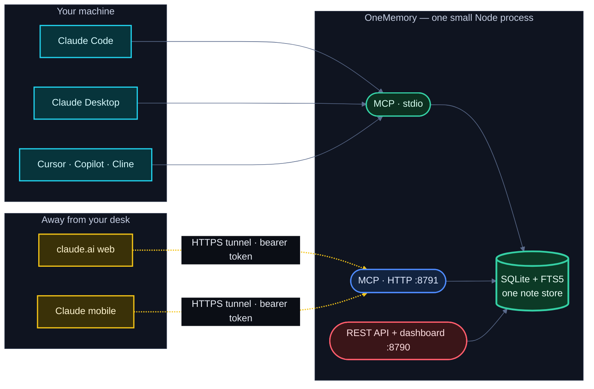

# Architecture

One store, reached three ways — all pointing at the same
`ONEMEMORY_DB_PATH`, so a note written through any one of them is
immediately visible through the others:

- **`src/store.ts`** — the shared state layer. SQLite via Node's built-in
  `node:sqlite` (no native module to compile), with an FTS5 index kept in
  sync by triggers so search never goes stale after a write. Notes carry a
  `rev` for compare-and-swap, a provenance `source`, tags, and namespaces.
- **`src/api.ts`** — a small HTTP/JSON API + a built-in web dashboard, on
  plain `node:http` (no framework).
- **`src/mcp-server-core.ts`** — the transport-agnostic MCP server with twenty-two
  tools, shared by both MCP transports.
- **`src/mcp-stdio.ts`** — stdio entry point for local Claude Code / Desktop
  / editors.
- **`src/mcp-http.ts`** — the MCP-over-HTTP (Streamable HTTP) endpoint the
  tunnel points at. Stateless: one shared store, a fresh server + transport
  per request.
- **`src/lint.ts`** — the write-time memory linter (secrets + prompt
  injection) and the `ONEMEMORY_LINT` policy; the store applies it on every
  create/update/import.
- **`src/changes.ts`** — the change feed service (`since` parsing, the
  per-consumer "last" marker) over `Store.changes()`.
- **`src/task-core.ts`** — the command-task queue rule shared by the runner and `runner_status` (no runner code,
  so the server can use it). `src/liveness.ts` builds on it (no import cycle).
- **`src/trust.ts`, `src/attest.ts`** — the distrust rule matchers (one JS, one SQL using a single `json_each` membership test per row, tested to agree), writer ids, and
  the Ed25519 export attestations ([trust.md](./trust.md)). `Store.readVisible` / `filterVisible` are the one gate
  every by-id and set read goes through (`test/trust-gate-guard.test.ts` enforces it).
- **`src/stream-json.ts`** — streaming reader for a JSON backup (`import --file`), so a restore holds one batch in memory.
- **`src/sync.ts`** — Markdown export / three-way import.
- **`src/start.ts`** — boots the API/dashboard **and** the MCP-over-HTTP
  endpoint in one process on a single store (what `npm start`, the CLI, and
  Docker run).

## MCP tools

| Tool | Scope | What it does |
|---|---|---|
| `state_write` | write | Create a note, or update one by `id` (optional `if_rev` compare-and-swap, `source` provenance) |
| `state_read` | read | Read one note; `neighbors: true` attaches up to 10 similar notes |
| `state_search` | read | Keyword / semantic / hybrid search, optional `when` time filter |
| `state_relevant` | read | Extract keywords from a natural message, permissive OR search |
| `state_list` | read | Newest-first page of notes |
| `state_delete` | admin | Delete a note |
| `memory_stats` | read | Totals, most-read notes, never-read and stale counts |
| `memory_since` | read | Change feed: what was created/updated/deleted since a time ([change-feed.md](./change-feed.md)) |
| `task_put` | write | Create/update a task on the shared board (status, next_step, owner, priority, due, parent, blockers, `client_key`, `if_rev`; `command` + `target` queues a runner command) ([tasks.md](./tasks.md)) |
| `task_get` | read | One task in full (notes, command, approval state, result) |
| `task_list` | read | List tasks (default: all but done), filter by status/owner/parent |
| `task_claim` | write | Take / heartbeat / release a task with a lease (compare-and-swap) |
| `task_approve` | admin | Approve (or revoke) a command task for the PC's runner ([RUNNER.md](https://github.com/calasdan-sketch/onememory/blob/main/docs/RUNNER.md)) |
| `runner_status` | read | Is the PC's runner listening, and how many approved commands are waiting / expiring / expired ([RUNNER.md](https://github.com/calasdan-sketch/onememory/blob/main/docs/RUNNER.md)) |
| `session_handoff` | write | Leave a structured handoff (done / pending / decisions / next step) |
| `catch_up` | read | One call: changes since this consumer last looked + open tasks (compact) + latest handoffs |
| `memory_ack` | read | Confirm a manual-ack change-feed page (`ack_token`) |
| `memory_consolidation_candidates` | admin | Near-duplicate pairs (O(n²), single-flight, time-budgeted) |
| `memory_consolidate` | admin | Merge 2+ notes (`dry_run`, `keep_sources`) |
| `memory_rebuild_edges` | admin | Rebuild the similarity graph (confirmation gate above 2,000 notes) |
| `memory_quarantine` | admin | List / approve / reject writes the memory linter held ([memory-linter.md](./memory-linter.md)) |
| `trust_policy` | admin | The distrust list and the trusted export signers: `list`, `distrust`, `undistrust`, `add_attester`, `remove_attester`. A namespace-pinned admin sees and changes only its own namespace's rules ([trust.md](./trust.md)) |

## HTTP API

`POST /notes` · `GET /notes/:id` · `PUT /notes/:id` · `DELETE /notes/:id` ·
`GET /notes` · `GET /search` · `POST /relevant` · `GET /stats` ·
`POST /rebuild-edges` · `GET /export` · `POST /import` ·
`POST /notes/:id/archive` · `POST /notes/:id/restore` · `POST /sweep-expired` ·
`GET /changes`, plus open
`GET /health` (liveness) and `GET /ready` (DB-touch readiness, used by the
Docker healthcheck) and the dashboard at `/`. Every route except `/health`,
`/ready`, and the dashboard requires `Authorization: Bearer <token>`.
`POST /relevant` takes `{ message, limit?, namespace? }` and mirrors the
`state_relevant` tool (read-scoped, despite the POST method).
`GET /stats` mirrors the `memory_stats` tool (read scope, namespace-gated
like the tool). `POST /rebuild-edges` takes `{ threshold?, namespace?, confirm? }`
and mirrors the `memory_rebuild_edges` tool (admin scope; confined to the
server's own namespace when namespace resolution is active; above 2,000
notes in scope it answers `409` with `{ notes, pairs }` unless `confirm` is
`true`, and `409` while another rebuild is running). `GET
/notes/:id` accepts `?neighbors=true` to attach up to 10 same-namespace
similar notes with similarity scores and staleness fields, mirroring the
MCP `state_read` `neighbors` option.

This plain REST API is also how non-agent tools plug in. **n8n**, for
example, can read and write the store via an HTTP Request node (or its MCP
Client node) — see [INFRA.md](../INFRA.md) § "Use with n8n".

`GET /changes` mirrors `memory_since` (read scope; see [change-feed.md](./change-feed.md)); it requires a `since` parameter and answers `400` without one. `&wait=<0-55>` holds the request open until something changes ([live wait](./change-feed.md#live-wait)).
`POST /tasks` · `PUT /tasks/:id` · `GET /tasks` · `GET /tasks/:id` · `POST /tasks/:id/claim` · `POST /tasks/:id/approve` (admin) · `POST /handoffs` · `GET /handoffs` · `GET /catch-up` · `POST /ack` are the REST side of the task board, handoffs, catch-up and acknowledged reads ([tasks.md](./tasks.md), [change-feed.md](./change-feed.md)); writes need write scope, reads read scope, and namespaces apply as for `/notes`.

### Naming convention (REST vs MCP)

The two surfaces grew separately, so the names differ in a few predictable
ways. The rules, so you can guess the other side:

- REST uses nouns and kebab-case paths (`/catch-up`, `/changes`, `/tasks/:id/claim`);
  MCP uses snake_case verbs-or-nouns (`catch_up`, `memory_since`, `task_claim`).
  `catch_up` and `/catch-up`, `task_put` and `POST/PUT /tasks` are the same operation.
- Request fields are snake_case on both (`next_step`, `if_rev`, `client_key`,
  `ack_token`, `exclude_self`). REST query parameters are the same names.
- Old name wins where both exist: the live-wait length is `wait` on REST and
  `wait_seconds` on MCP. Both surfaces now accept **both** spellings
  (`wait` and `wait_seconds`), so either works anywhere. Prefer `wait_seconds`.
- Prefixes: `state_*` are note CRUD/search (kept for 1.0 compatibility),
  `memory_*` are store-level views and maintenance (`memory_since`,
  `memory_stats`, `memory_ack`), `task_*` and `session_handoff` / `catch_up`
  are the task board. New tools follow `task_*` / `memory_*`; nothing is renamed.
`GET /runner/status` mirrors the `runner_status` tool (read scope; per-runner `targets`, counts and ages, never command text). `GET /trust`, `POST /trust/distrust`, `DELETE /trust/distrust`, `POST /trust/attesters` and `DELETE /trust/attesters/:key_id` are the admin-only REST side of `trust_policy` ([trust.md](./trust.md)); `GET /export?attest=1` adds signatures (the default is the plain `{"notes": [...]}`). `include_distrusted` on any read route is admin-only (403 otherwise).
`POST /notes/:id/archive` and `POST /notes/:id/restore` soft-forget and bring back a note by id; `POST /sweep-expired` archives every note past its TTL (all three are admin scope; see [encryption-retention.md](./encryption-retention.md)).
`POST /notes` and `PUT /notes/:id` answer `202 { quarantined: { id, reasons } }`
when the memory linter holds the write, and add a `warnings` array under
`ONEMEMORY_LINT=warn`. `POST /import` adds `quarantined` / `rejected` arrays
when non-empty.

## Schema

SQLite, versioned with `PRAGMA user_version`; migrations run on open, all
in one `BEGIN IMMEDIATE` transaction that re-reads the version under the
lock (several processes can open an old database at once), and every step
is idempotent. v1 rev + source, v2 note_vectors, v3 access tracking, v4
similarity edges, v5 `_meta` + gated FTS trigger, v6 edge indexes, v7
`quarantine`, `sync_map`, `sync_base`, `idx_notes_updated`, v8 `change_log`
(+ triggers; replaces the 1.1.0-rc `note_tombstones`) and
`quarantine.set_namespace`, v12 `change_log.actor`, v13 `notes.written_by` /
`created_by` / `imported_written_by` (+ `change_log.written_by`,
`quarantine.written_by`; see [provenance.md](./provenance.md)), v14 (1.4.0) `notes.attested_writer` / `attested_by` /
`merged_from_writers` (+ the matching `change_log.note_*` columns) and three tables: `trust_distrust` (the distrust
rules, per namespace), `trust_attesters` (trusted export signers: key, pinned `server_id`, `label`, optional
`not_after`) and `trust_log` (who changed the policy; newest 1000 rows kept); see [trust.md](./trust.md). Opening a
v1-v13 database first writes a verified `<db>.pre-v14-backup`. There is no downgrade path: once a 1.1.0 binary
has opened a database, don't go back to 1.0.x.
